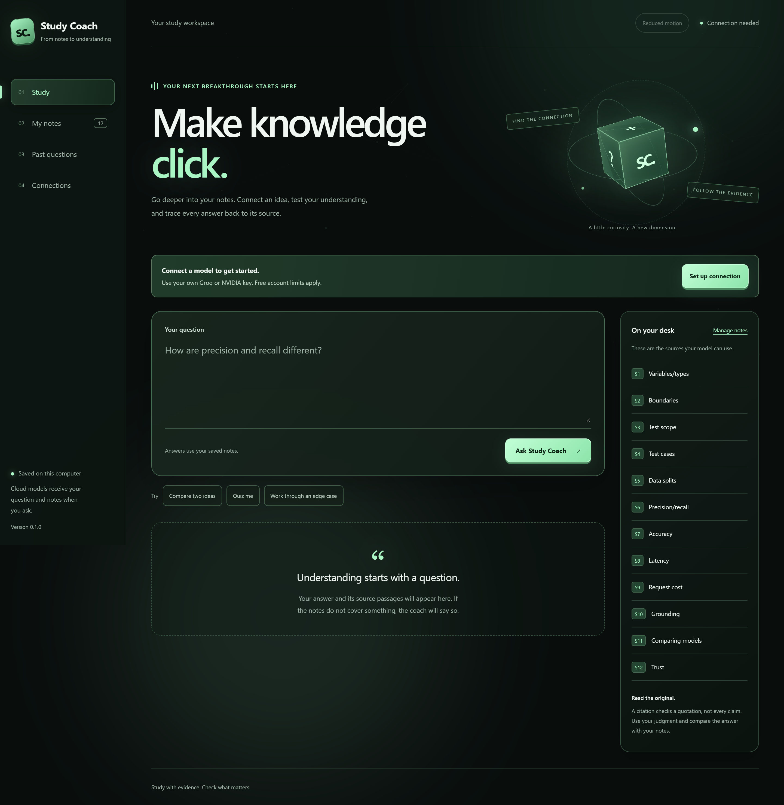
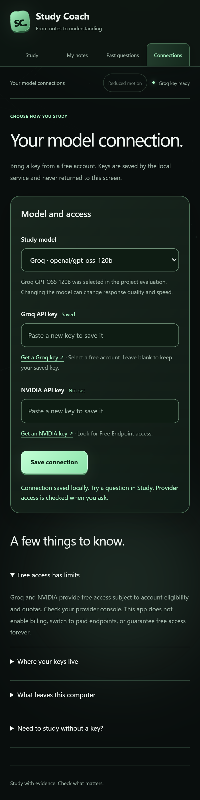
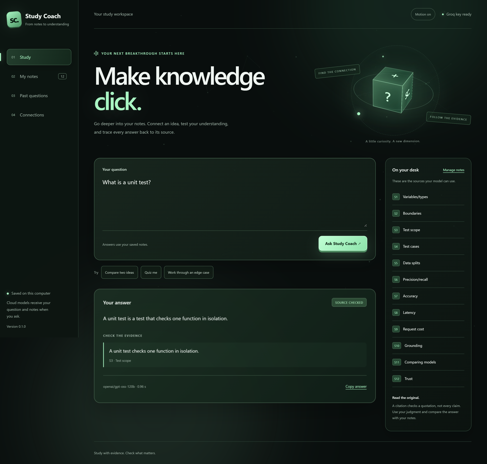

# AI assisted development evidence

Codex assisted with implementation, dataset checks, review, and local verification. This document records actual short request excerpts and concrete corrections. It is not a claim that a student independently wrote every line, or that a generated answer substitutes for a real evaluation.

## Key conversation excerpts

1. User: `code it in rust`. Result: a Rust library supplies `core::answer`, the CLI evaluator calls that function, and the later local service reuses it. The browser uses ordinary HTML, CSS, and JavaScript while model calls and storage remain in Rust.
2. User: `make a .env file for me to put the api keys in`. Result: local configuration accepts user entered credentials. The distributable creates its own blank application data file and never bundles or copies the developer credential file.
3. User: `the ui should be high defition UI 3d/4d high defition`. Result: after the working prototype, the interface was revised to a dark dimensional workspace with CSS 3D geometry, orbital motion, pointer parallax, and a high density canvas. A visible motion switch and system reduced motion support retain accessibility. Screenshots below record the actual browser layout.

## Where the assistance needed correction

The first UI draft allowed 32,000 characters per source and 8,000 per question, exceeding the service limits. These were corrected to the service's byte limits with UTF8 checks before submission. A browser check confirms the phone layout has no horizontal overflow.

Review found that saving only a profile could accidentally persist credentials inherited from the parent process. The service now writes a credential only when the user explicitly supplies it. A regression checks that a profile update leaves a blank credential file blank.

A separate review reproduced data loss when two application instances loaded and overwrote the same data folder. The service now retains an operating system file lock for its lifetime and refuses a second owner. This is a reliability correction with source preservation checks, not an invented model quality gain.

The baseline grader also accepted a definition when the user asked for a quiz question and answer. Its old grade remains in historical evidence. The revised prompt asks for completion of the requested task, while the controlled comparison keeps the old rubric frozen so the prompt is the only experimental variable. A more complete task rubric remains future work.

## Browser evidence

The browser test uses a clearly labelled answer fixture to test rendering and error recovery without making paid or accidental provider calls. [The separate baseline prototype receipt](evidence/prototype-baseline-2026-11-08.json) records a real Groq answer and checked citation. [The test source](../tests/ui-smoke.mjs) makes the fixture boundary inspectable.

[The live browser receipt](evidence/ui/live-verification.json) records one actual grounded Groq request, a verified quotation, and restoration from history without another model request. The phone view had no horizontal overflow and the browser reported no JavaScript errors. This closes the real browser to model path independently of the presentation fixtures.

There is no manufactured commit history. Reviewed work uses the owner's required Git identity and actual commit dates. The course's requirement for steady development history cannot be recreated by backdating commits.
