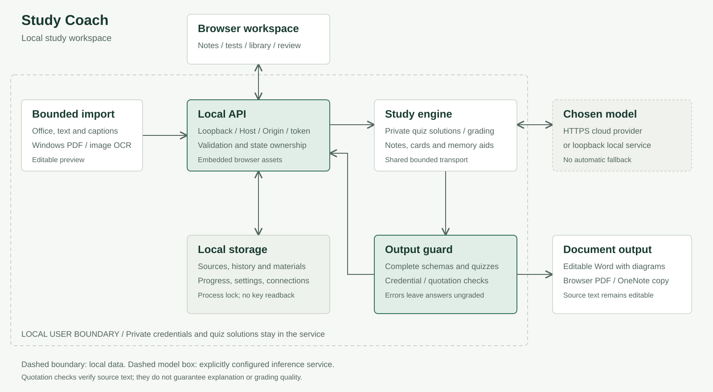
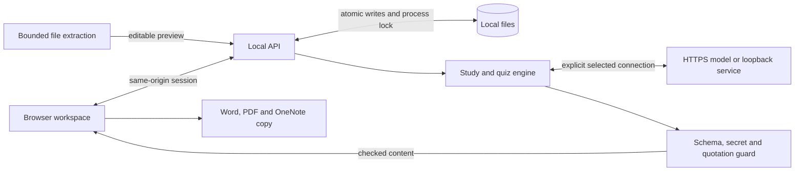

# Study Coach architecture

[Open the standalone architecture diagram](architecture.html).

Study Coach is a local Rust application with an embedded browser workspace. A loopback API owns credentials, saved data, source validation, and private quiz solutions. Browser code owns navigation, test forms, diagrams, printing, and clipboard export. Imports and exports stay local; explicit study actions send notes to the selected inference service.

## Tests and review progress

Creating a test returns question identifiers, text, format, and choices. Solutions, accepted answers, and a snapshot of the chosen sources remain in the service. Each test and study material can use the full notebook or explicitly selected source IDs. Selection is checked on the server before model generation and citation verification. Requests support multiple choice, open response, fill in the blank, and custom instructions, with 1 to 30 questions generated in batches of at most five. Count, format, duplicate, and complete-answer checks must pass before an exam opens.

Exact grading preserves signs, decimals, and operators. Other free-text responses are assessed by the selected model against the source snapshot and reference. Partial responses permit a retry; wrong or revealed responses show the solution. Correct and incorrect results are terminal. Transport or schema failures leave the answer ungraded. Credential changes invalidate active tests. Restarting the service replaces the active test while retaining recorded progress.

`progress.json` stores the latest result per attempted question, up to 100 records. The dashboard reports correct, partial, and incorrect answers by topic. It does not claim a validated mastery score. Model grading is guidance and can be wrong.

## Imports and generated materials

`documents.rs` caps uploads at 12 MiB. Text, Markdown, CSV/TSV and caption files use bounded UTF-8 extraction. A fixed Windows PowerShell helper reads DOCX, PPTX and XLSX with .NET ZIP/XML APIs, rejecting macros, DTDs, unsafe archive paths, and excessive expansion. Windows native OCR handles screenshots and rendered PDF pages. Extraction is editable before saving because OCR can be wrong.

Video imports use a supplied transcript, or embedded captions when FFmpeg is available. Container demuxers and protocols are restricted, and MOV external references are disabled. There is no automatic speech transcription or video scene understanding. Missing captions or extraction support produces a clear transcript-required error. Rich binary extraction currently requires Windows; text imports and Word export are portable.

Extracted text is limited to 180 KiB. Bulk saving splits UTF-8 safely into bounded sources and commits the whole change atomically. The library has at most 64 sources totaling 180 KiB, with 16 KiB per source and 160 bytes per title. A full library can reject a valid upload without partial writes.

`study.rs` validates notes, five-card recall sets, original text memory aids, and structured diagrams. Note styles, document types, and custom preferences are bounded data in the generation request. Acronyms and short original song lyrics include source-fact mappings. The browser draws diagram nodes and edges from validated JSON, not model-generated executable HTML or SVG.

## Connections and trust boundaries

Templates cover Groq, NVIDIA, OpenAI, OpenRouter, Ollama, and another OpenAI-compatible service. Existing bundled models remain available. Users can add a connection name, model ID, chat-completions URL and key. Templates describe supported protocols, not every model available from each provider.

Remote custom endpoints require HTTPS and a key; strict loopback HTTP can be keyless. Validation rejects URL credentials, queries, fragments, ambiguous hosts, unsupported protocols and header injection. Curl never follows redirects. Keys are supplied through standard input, not process arguments, and are omitted from public state. Existing study data is checked before accepting a new credential; imported and generated content is checked for configured secrets.

Mutations require the local session token, expected Host and Origin, and JSON content type. Responses use a restrictive Content Security Policy, no-store caching, and text rendering for source/model content. A malicious process running as the same account is outside this boundary. Local credential files are not an encrypted secret vault.

## State and output ownership

| Owner | State or output | Boundary |
|---|---|---|
| Local API | sources.json, settings.json, history.json | Atomic writes; up to 50 accepted answers |
| Connections | .env, connections.json | Local keys; private file permissions; no key readback |
| Study library | materials.json | 100 generated items, at most 8 MiB |
| Review dashboard | progress.json | Latest 100 question results |
| Active test | Service memory | Hidden solutions and immutable source snapshot |
| Word exporter | Downloaded .docx | Editable OOXML text and vector diagram with text equivalent |
| Browser print view | PDF | User selects Save as PDF; diagram and expanded cards included |
| Rich clipboard | OneNote | Paste formatted text and diagram into a page; no account integration |

Application data lives in `%APPDATA%\StudyCoach` on Windows, `$XDG_DATA_HOME/study-coach` or `~/.local/share/study-coach` on Linux, and `~/Library/Application Support/StudyCoach` on macOS. Installation files remain separate. An operating-system lock prevents competing app instances from overwriting the same folder. New Windows directories receive a restricted ACL; Unix directories use 0700 and files 0600.

The historical CLI evaluator retains frozen cases, prompts, scoring and raw results. Application checks are additional guards, not retroactive changes to evaluation scores. Exact quotation checks prove a passage occurs in a source; they do not prove semantic support or assessment quality. Provider quotas and account billing remain account-specific.
