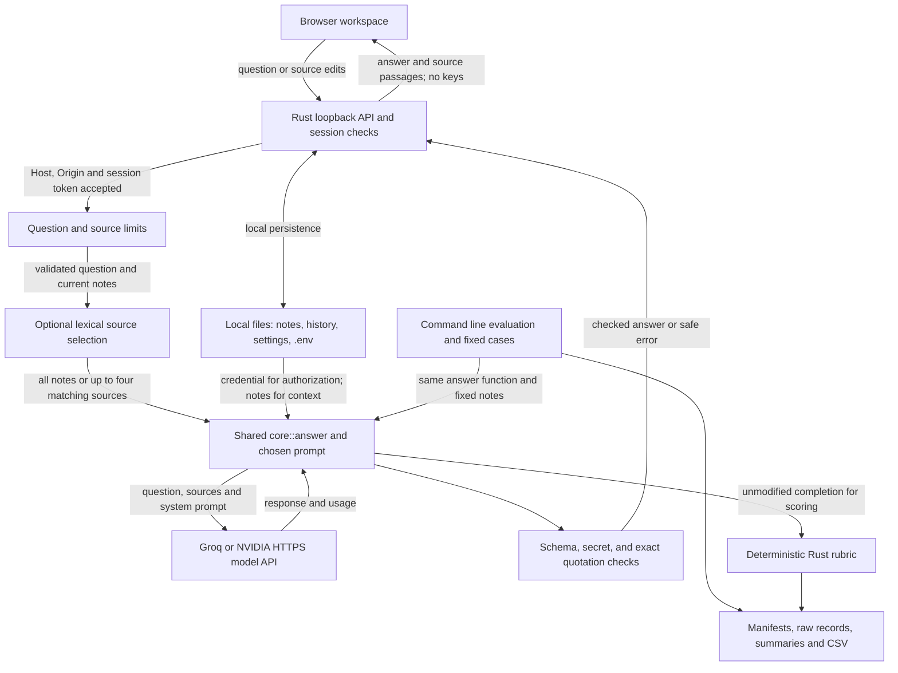

# Application architecture

The installed application is a Rust executable with embedded HTML, CSS, and JavaScript. It serves a browser workspace on an automatically selected IPv4 loopback port. There is no hosted application server, account database, or user sign in. Provider credentials belong to each local user.

## Components and state

| Component | Technology and responsibility | Connection to the model |
|---|---|---|
| Workspace | Original HTML, CSS, and browser JavaScript; Study, My notes, Past questions, Connections | Sends explicit user actions to the local API; renders source text as text rather than HTML |
| Local service | Rust `std::net`, bounded HTTP parsing, same origin requests, random session token | Validates requests and calls `core::answer`; exposes no arbitrary endpoint or file path option to the browser |
| Model adapter | Rust and system curl over fixed HTTPS endpoints | Groq or NVIDIA receives the question, system prompt, and complete current source collection |
| Context selection | Rust deterministic lexical ranking with stable ties | Full context by default; optional retrieval sends up to four positively matching sources, or the complete collection when there is no match |
| Credential storage | `.env` in the user's application data folder | The local process loads keys for provider authorization; API state returns only configured booleans |
| Study storage | `sources.json`, `settings.json`, and `history.json`; atomic replacement | Stores source text and up to 50 accepted responses; no external database |
| Output guard | Rust schema, credential, source ID, duplicate, and exact substring checks | Withholds invalid model answers before display or persistence; this does not prove semantic entailment |
| Evaluator | Same core answer function, frozen cases and deterministic rubric | Stores raw completions, including failures, so invalid output remains measurable |
| Distribution | Native executable, launchers, checksum manifest, installation scripts | Creates no cloud account and contains no developer key; compilation embeds only public assets and synthetic sample notes |

The application data folder is `%APPDATA%\StudyCoach` on Windows, `$XDG_DATA_HOME/study-coach` or `~/.local/share/study-coach` on Linux, and `~/Library/Application Support/StudyCoach` on macOS. The installation folder is separate. Unix data directories use mode `0700` and new files `0600`. Fresh Windows directories receive a restricted ACL; existing directories keep their owner's ACL policy. This file storage is not an encrypted secret manager.

An operating system file lock is acquired before loading application state and retained for the service lifetime. A second launch for the same data folder is refused, preventing cached copies from overwriting each other. The lock releases when the process exits, including a crash. Its empty lock file is intentionally retained.

## Guardrails and failure paths

The browser sends a random local session token for mutations. The service checks Host and Origin, limits headers and bodies, blocks path traversal, and serves a restrictive Content Security Policy. Only IPv4 loopback is bound. A local malicious process running as the same account is outside this session token boundary; this is not a remote multiuser deployment.

Empty or punctuation only questions receive a local clarification. Other valid questions call the selected model. Missing keys, quota errors, unavailable models, timeouts, and unverified quotations return actionable messages. There is no paid or automatic provider fallback. Changing a connection requires a user action.

The service accepts at most 64 sources totaling 180 KiB, each source text at most 16 KiB and title at most 160 UTF8 bytes. Questions are limited to 4,000 UTF8 bytes. The default sends the full collection. `--context retrieval` uses the same lexical selection function as the retrieval evaluator, without expected answers or grading criteria. It is a basic retrieval alternative rather than semantic search or an embedding database. Plain text and Markdown import does not extract PDFs, Office files, images, or audio.

The evaluation intentionally scores the raw shared core response. Application checks additionally suppress unsafe output instead of showing it. A strict evaluation pass satisfies the exact quotation conditions, but a failure may represent a withheld answer, a valid paraphrase rejected by the rubric, or a task completion error. Reports distinguish those outcomes.
