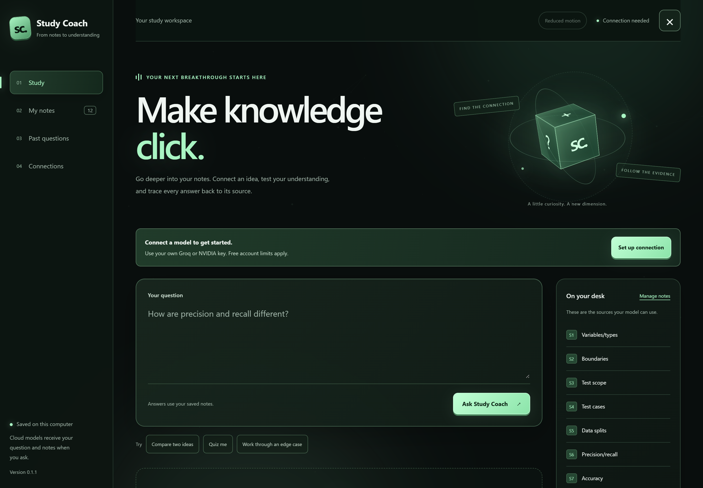
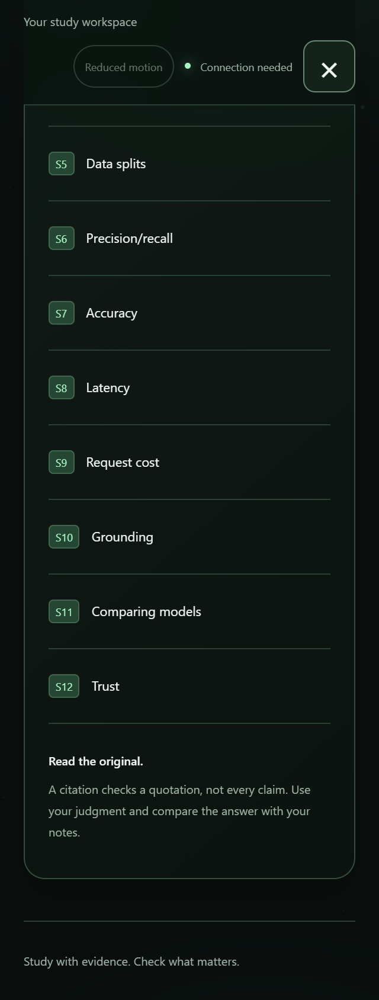
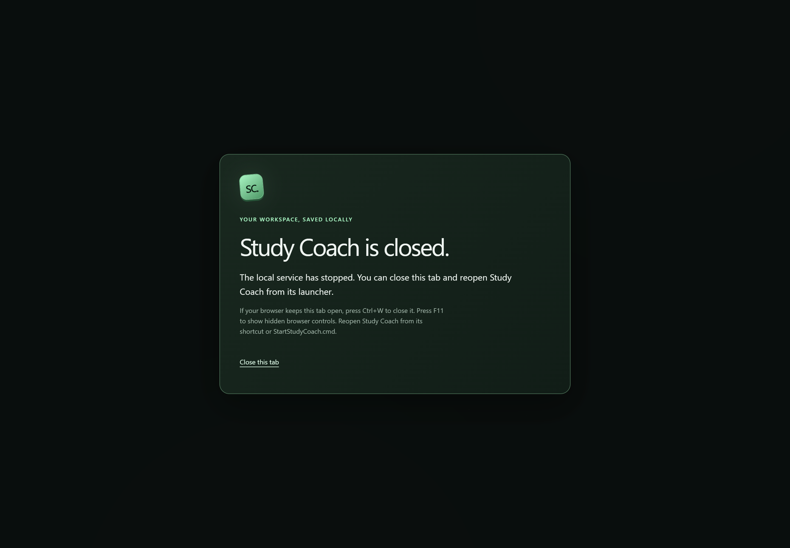

# Application close and reopen plan

The application needs a visible close control even when browser controls are hidden. A close action must stop the local Rust service and release its data folder lock. Reopening through the launcher must load the same saved notes, keys, settings, and history.

1. Add an authenticated shutdown endpoint that returns its response before exiting the service loop.
2. Add a labelled X in the persistent workspace header, with a clear closing state and a closed page when the browser will not close its own tab.
3. Protect unsaved notes and connection edits. If an answer is running, explain that it will finish before shutdown rather than claiming cancellation.
4. Test unauthorized shutdown, successful shutdown, and a second launch with the same saved data. Check the button at desktop and phone widths.
5. Rebuild and verify the installable package. Preserve the already submitted `alpha` snapshot and recorded milestone evidence.

Completion requires an actual browser click that stops the process, a successful relaunch, retained local data, and a verified package. The class presentation and incoming peer review response remain the student's separate course items.

## Verified result on November 9, 2026

Version 0.1.1 adds a persistent X labelled **Close Study Coach**. It uses the existing request token and origin checks to request shutdown, receives a complete JSON response, and exits the Rust service loop normally. The data folder lock is released by normal process exit. If an answer is running, the service finishes that request before processing shutdown. This does not cancel a model request or immediately stop its provider cost.

The interface asks before discarding unsaved notes, keys, or model selection. A failed shutdown can be retried or return to the workspace. An answer received while closing remains available after returning from a failed shutdown. Motion stops while the closed screen is displayed. The browser may refuse to close its own tab; the fallback confirms shutdown and explains `Ctrl+W` and reopening through the launcher.

* `cargo test --offline --locked --all-targets` with the Windows GNU toolchain: 59 passed, 0 failed, including a real HTTP shutdown and restart regression.
* `node tests/lifecycle-ui.mjs` against the release executable: **PASS: 10 lifecycle browser checks**. Two actual local processes stop normally and use the same data folder. Notes, history, profile, and a fake credential survive reopening. Browser checks cover 1440, 390, and 320 pixel widths.
* `node tests/ui-smoke.mjs` against the release executable: **PASS: 18 browser checks**.
* Formatting, JavaScript syntax, Rust static checks, and Clippy with warnings denied passed.
* `scripts/test-package.ps1` verified the new Windows archive: **Package checks PASS**. [Package receipt](LIFECYCLE_PACKAGE_VERIFICATION.json) records its hash and checks. The original alpha package receipt remains separate.

The [browser receipt](evidence/lifecycle/lifecycle-verification.json) labels its fixtures. Provider replies and a browser refusing `window.close()` are simulated; service shutdown, process exit, persisted data, and reopening are real. No provider requests were made for this update. Native Linux and macOS execution remains unverified.

The previously submitted `alpha` tag and evaluation results are preserved. This update is separate from that frozen submission snapshot.

